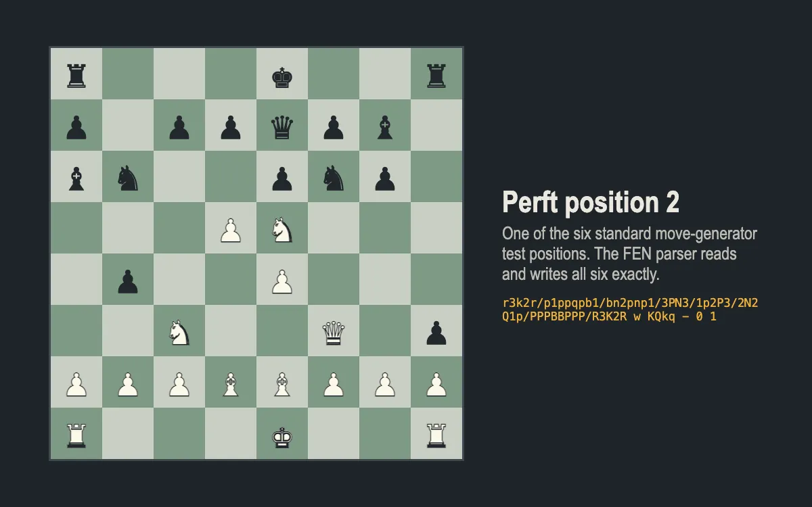

# mekchess

A chess engine workspace in Rust, built from the board up as a long-term project for learning engine design, testing and, later, neural-network evaluation.



**Status:** early. `chess-core` has the board representation and FEN parsing and serialization (22 tests; 26 across the workspace). Legal move generation is next. The engine, UCI and arena crates are placeholders, and `training/` and `ui/` contain plans only.

Developed on a self-hosted GitLab; this GitHub repo is a read-only mirror.

## What exists today

`crates/chess-core`:

- **Squares** use Little-Endian Rank-File indexing (a1 = 0, h8 = 63) with algebraic parse and format.
- **Board** is a 64-entry mailbox plus side to move, castling rights, en passant target and the two move clocks.
- **FEN** parse and serialize for all six fields, including the rank flip (FEN lists rank 8 first; the board stores a1 at index 0) and run-length encoding of empty squares. Parsing returns a typed `FenError` naming the first bad field.
- **Tests** check round trips for every piece, castling field and placement, reject malformed input, and require the six standard perft positions to round-trip byte for byte.

## Design

Each engine is planned as a **library crate** plus a **thin UCI binary**:

- The in-process arena calls engines as Rust libraries on the shared `chess-core` board, with no text round trip, for fast local iteration.
- The same engines compile to UCI binaries for fast-chess (SPRT strength testing), external GUIs and a Lichess bot bridge.

So `chess-core` is the shared foundation inside the Rust workspace, and UCI is the boundary where mekchess meets other tools. The workspace is deliberately polyglot: Rust for engines, Python for NNUE training, TypeScript for a debug UI, and existing tools (fast-chess, OpenBench, lichess-bot) for problems already solved.

## Layout

| Path | Purpose | State |
|------|---------|-------|
| `crates/chess-core/` | Board, squares, pieces, FEN. Later: Zobrist, move generation, perft. | in progress |
| `crates/uci/` | Shared UCI protocol loop and `Engine` trait. | planned (stub) |
| `crates/engine-classical/` | Alpha-beta search with a handcrafted eval (lib + UCI bin). | planned (stub) |
| `crates/engine-nnue/` | NNUE engine with hand-written quantized inference (lib + UCI bin). | planned (stub) |
| `crates/arena/` | In-process engine-vs-engine match runner. | planned (stub) |
| `training/` | Python NNUE training pipeline (nnue-pytorch). | planned (README only) |
| `ui/` | Web debug visualizer (Vite, React, chessground). | planned (README only) |
| `books/` | Opening books for test games. | planned (README only) |

The full plan and its order are in [docs/roadmap.md](docs/roadmap.md).

## Build and test

Requires Rust 1.85 or newer (edition 2024).

```sh
git clone https://github.com/mekstromjr/mekchess.git
cd mekchess
cargo test --workspace
```

CI (GitLab) runs the same four checks on every push:

```sh
cargo fmt --all -- --check
cargo clippy --all-targets --workspace -- -D warnings
cargo build --workspace --all-targets
cargo test --workspace
```

Once move generation lands, a perft test against the standard positions becomes the correctness gate in this pipeline.

## License

MIT. See [LICENSE](LICENSE).
